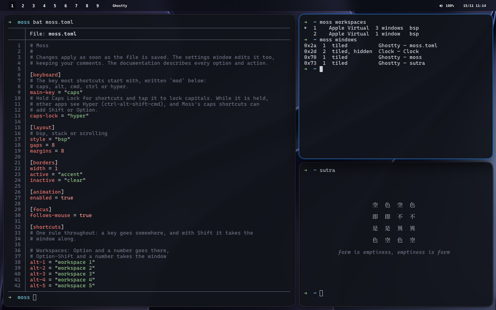
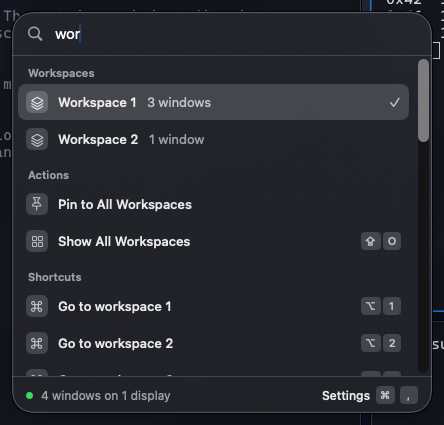
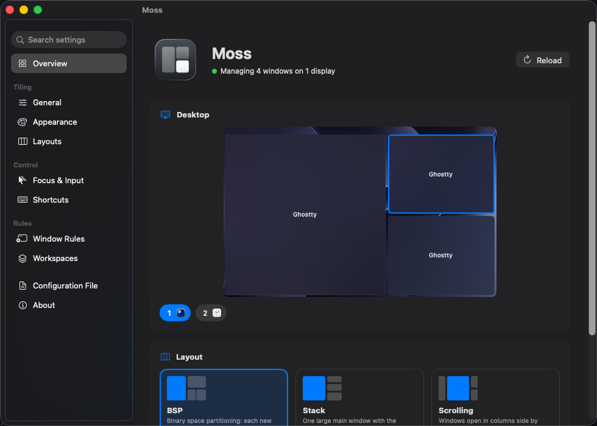

# Moss

A dynamic tiling window manager for macOS.

Windows tile as they open. You move them with the keyboard or the mouse, set Moss up in a TOML
file or a settings window, and script it from the command line.



## Features

- **Layouts**: BSP, stack (a main area beside the rest) and scrolling (columns on a strip).
- **Workspaces** on each display, created as you need them, and scratchpads that drop down over
  them. No macOS Spaces, and no need to disable System Integrity Protection.
- **Keyboard**: Caps Lock becomes a key for Moss's shortcuts and a Hyper key (⌃⌥⇧⌘) for other
  apps. Shortcuts can repeat while held, and modes give keys a temporary meaning.
- **Mouse**: drag or resize any window with the main key held. Focus can follow the pointer.
- **Rules** that float, place, size or tag windows by app or title.
- **Tabs**: several windows in one tile.
- **Borders** that follow each window's rounded corners.
- **A palette** that finds windows, workspaces, actions and shortcuts as you type.
- **The `moss` command**: every action from the command line, answers in JSON, and an event
  stream for status bars.
- **A settings window** with live previews, a shortcut recorder and rule editors. It keeps the
  comments in your configuration file.
- **Each app gets its own accessibility thread**, so a frozen app never stalls the others.

## Installing

Requires macOS 26 or later.

1. Download `Moss-<version>.zip` from the [latest release](https://github.com/ondreej/moss/releases/latest)
   and unzip it.
2. Move `Moss.app` to Applications and open it.
3. Moss is not notarized by Apple, so macOS refuses to open it the first time. Click **Done**,
   then click **Open Anyway** in System Settings › Privacy & Security.

Instead of step 3, you can clear the download flag in Terminal before opening Moss:

```sh
xattr -dr com.apple.quarantine /Applications/Moss.app
```

The [`moss` command](docs/cli.md) is inside the app; link it onto your `PATH` to use it.

To update, quit Moss and replace the app. Every version has a signature of its own, so macOS
no longer recognizes the Accessibility access you gave the old one, even though its switch stays
on. Remove Moss from System Settings › Privacy & Security › Accessibility with −, then allow it
again.

### Building from source

Requires Swift 6.2 (Xcode 26) or later.

```sh
Scripts/build-app.sh
open build/Moss.app
```

`Scripts/release.sh` publishes the pushed commit as a GitHub release.

## Getting started

On first launch Moss creates `~/.config/moss/moss.toml` and asks for the Accessibility
permission, which it needs to move other apps' windows.

Hold Caps Lock (`⇪`) for Moss's shortcuts; tap it to lock capitals as usual. A key goes
somewhere, and with `⇧` it takes the window along.

| Shortcut | Action |
| --- | --- |
| `⌥ 1`…`0` | Switch workspace |
| `⌥ ⇧ 1`…`0` | Take the window to a workspace |
| `⇪ H J K L` or arrows | Move focus |
| `⇪ ⇧ H J K L` or arrows | Move the window |
| `⇪ ⌥ H J K L` or arrows | Resize the window |
| `⇪ Tab` | Back to the previous workspace |
| `⇪ Space` | Search windows, workspaces and actions |
| `⇪ W` / `⇪ F` / `⇪ T` | Close / fullscreen / float or tile the window |
| `⇪ G` / `⇪ /` | Tabs / flip the split |
| `⇪ S` / `⇪ ⇧ S` | Show the scratchpad / send the window there |
| `⇪ O` | See every workspace at once |
| `⇪` + drag | Move a window (left button) or resize it (right button) |
| `⇪` + scroll | Go through the workspaces |

To open apps, bind a shortcut to `run`, as in the example under [Configuration](#configuration).

`⇪ Space` opens the palette:

<p align="center"></p>

The settings window edits the same file and applies changes as you make them:



## Configuration

Shortcuts, the palette and the command line all run the same actions:

```toml
[layout]
style = "bsp"
gaps = 8
margins = 8

[shortcuts]
mod-return = "run open -na Terminal"
mod-3 = "workspace 3"
mod-l = { action = "resize by 20 0", repeat = true }

[[rules]]
if.app = "com.apple.calculator"
float = true
```

```sh
moss move-to-workspace 3
moss set layout.gaps 10
moss events
```

## Documentation

- [Configuration](docs/configuration.md): shortcuts, rules, workspaces and every option.
- [Actions](docs/actions.md): every action and its arguments.
- [The moss command](docs/cli.md): requests, JSON answers, events and the sockets.

## Testing

```sh
swift test                      # unit and integration tests
Scripts/build-e2e.sh            # end-to-end suite, see Tests/E2E/README.md
```

## License

[MIT](LICENSE)
